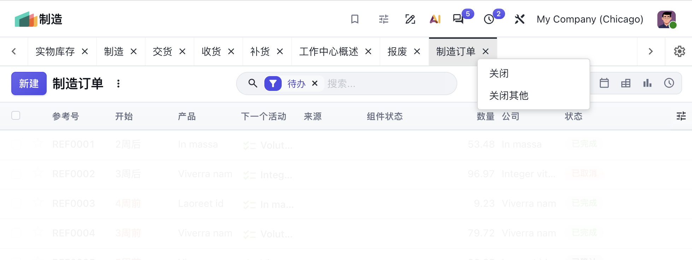

# Multi Tabs / 多标签页



为 Odoo 20 后端提供浏览器式的多标签页导航。

Browser-like multi-tab navigation for the Odoo 20 backend.

- 版本 / Version: 20.0
- 依赖 / Depends: `base`, `web`
- 许可证 / License: LGPL-3
- 作者 / Author: Hubin

---

## 功能 / Features

**中文**

- 每打开一个菜单或动作，就在标签栏新增一个标签，而不是覆盖当前页面。
- 已打开的标签保持挂载（切换标签不重新加载），表单中输入但未保存的内容不会丢失。
- 标签支持关闭（× 按钮）、右键菜单（关闭 / 关闭其他）以及齿轮菜单（关闭当前 / 关闭其他）。
- 左右箭头按钮可在标签之间前后切换。
- 跨应用切换标签时，会自动切换左侧应用菜单，并同步当前菜单高亮。
- 标签栏在主页（Home Menu）下自动隐藏；主页不占用应用标签。
- 安装后自带简体中文翻译。
- 社区版与企业版均可使用。

**English**

- Every menu/action opens in its own tab instead of replacing the current page.
- Opened tabs stay mounted, so switching tabs does not reload the view and unsaved form input is kept.
- Close a tab with the `×` button, the right-click context menu (Close / Close Other Tabs) or the gear menu (Close Tab / Close Other Tabs).
- Previous/next arrow buttons switch between tabs.
- Switching to a tab of another app switches the app menu and keeps the sidebar highlight in sync.
- The tab bar is hidden on the Home Menu, which never takes over an app tab.
- Simplified Chinese translation included.
- Works on both Community and Enterprise.

---

## 安装 / Installation

**中文**

1. 将 `cux_multi_tabs` 目录放入 `addons_path` 中的任一目录（如 `addons_local`）。
2. 重启 Odoo 服务。
3. 进入「应用」，点击「更新应用列表」，搜索 `Multi Tabs` 并安装。
4. 刷新浏览器页面。

**English**

1. Put the `cux_multi_tabs` folder in any directory listed in `addons_path` (e.g. `addons_local`).
2. Restart the Odoo server.
3. Open *Apps*, click *Update Apps List*, search for `Multi Tabs` and install it.
4. Reload the browser page.

> 修改 SCSS 后需要重启服务或升级模块（`-u cux_multi_tabs`），资源包会缓存在数据库中。
>
> After changing the SCSS, restart the server or upgrade the module (`-u cux_multi_tabs`): asset bundles are cached in the database.

---

## 使用 / Usage

**中文**

| 操作 | 说明 |
| --- | --- |
| 点击菜单 | 在当前标签中打开；若该根动作已有同名标签则复用 |
| 切换应用 | 在新标签中打开，原应用标签保留 |
| 点击标签 | 切换到该标签，同步菜单、URL 与应用侧边栏 |
| `×` | 关闭该标签；只剩一个标签时回到主页 |
| 右键标签 | 打开上下文菜单（关闭 / 关闭其他） |
| 齿轮按钮 | 关闭当前标签 / 关闭其他标签 |
| `‹` `›` | 切换到上一个 / 下一个标签 |

**English**

| Action | Behaviour |
| --- | --- |
| Click a menu | Opens in the current tab; reuses an existing tab with the same root action name |
| Switch app | Opens in a new tab, the previous app tab is kept |
| Click a tab | Activates it and syncs menu, URL and sidebar |
| `×` | Closes the tab; going back home when it was the last one |
| Right-click a tab | Context menu (Close / Close Other Tabs) |
| Gear button | Close current tab / Close other tabs |
| `‹` `›` | Switch to the previous / next tab |

---

## 实现说明 / Technical Notes

**中文**

- Odoo 20 的动作管理器（`action` 服务）已改为 Owl Plugin，控制器栈存放在闭包内，无法像 19 版那样整体替换服务。本模块改为 patch `ActionContainer`，通过 `ACTION_MANAGER:UPDATE` 与 `ACTION_MANAGER:UI-UPDATED` 事件跟踪标签。
- 每个标签的控制器保持挂载，非激活标签用 `visibility: hidden` 隐藏（不使用 `d-none`，避免布局重算导致页面抖动）。
- 标签切换不会触发 `UI-UPDATED`，因此模块额外在 `env.bus` 上抛出 `CUX_MULTI_TABS:TAB-ACTIVATED`（`{ actionId, appId }`），供侧边栏等组件同步高亮。
- 主页（`menu` 客户端动作）使用临时标签，切换到其它动作时立即卸载，避免 `o_home_menu_background` 类残留导致标签栏被隐藏。
- 标签栏中同时保留多个控制器会占用更多内存，标签越多开销越大。

**English**

- In Odoo 20 the action manager is an Owl Plugin whose controller stacks live in a closure, so the Odoo 19 approach of replacing the whole `action` service no longer works. This module patches `ActionContainer` and tracks tabs from the `ACTION_MANAGER:UPDATE` / `ACTION_MANAGER:UI-UPDATED` events.
- Every tab's controller stays mounted; inactive tabs are hidden with `visibility: hidden` (not `d-none`, which would re-trigger layout and make the page jump).
- A tab switch fires no `UI-UPDATED`, so the module also triggers `CUX_MULTI_TABS:TAB-ACTIVATED` (`{ actionId, appId }`) on `env.bus` for components such as the sidebar to follow the active action.
- The Home Menu (`menu` client action) uses a transient tab that is unmounted as soon as another action is shown, otherwise the leftover `o_home_menu_background` body class would keep the tab bar hidden.
- Keeping several controllers mounted uses more memory: the more tabs, the higher the cost.

---

## 目录结构 / Module Structure

```text
cux_multi_tabs/
├── __init__.py
├── __manifest__.py
├── i18n/
│   ├── cux_multi_tabs.pot      # 导出模板 / export template
│   └── zh_CN.po                # 简体中文 / Simplified Chinese
└── static/
    ├── description/
    └── src/
        ├── cux_action_container.js    # 标签状态与 ActionContainer patch
        ├── cux_action_container.scss  # 控制器层叠容器样式
        └── components/multi_tab/
            ├── cux_multi_tab.js       # 标签栏组件
            ├── cux_multi_tab.scss     # 标签栏样式
            └── cux_multi_tab.xml      # 标签栏模板
```

---

## 翻译 / Translations

**中文**

- 词条位于 `i18n/cux_multi_tabs.pot`，中文译文位于 `i18n/zh_CN.po`。
- 新增或修改模板中的文案后，需重新导出 POT 并补齐 PO，然后升级模块使翻译生效。
- 也可在「设置 → 翻译 → 导出翻译」中导出其它语言的 PO 文件进行翻译。

**English**

- Source terms live in `i18n/cux_multi_tabs.pot`, Chinese translations in `i18n/zh_CN.po`.
- After adding or changing UI strings, re-export the POT, update the PO files, then upgrade the module for the translations to apply.
- Other languages can be exported from *Settings → Translations → Export Translation*.
